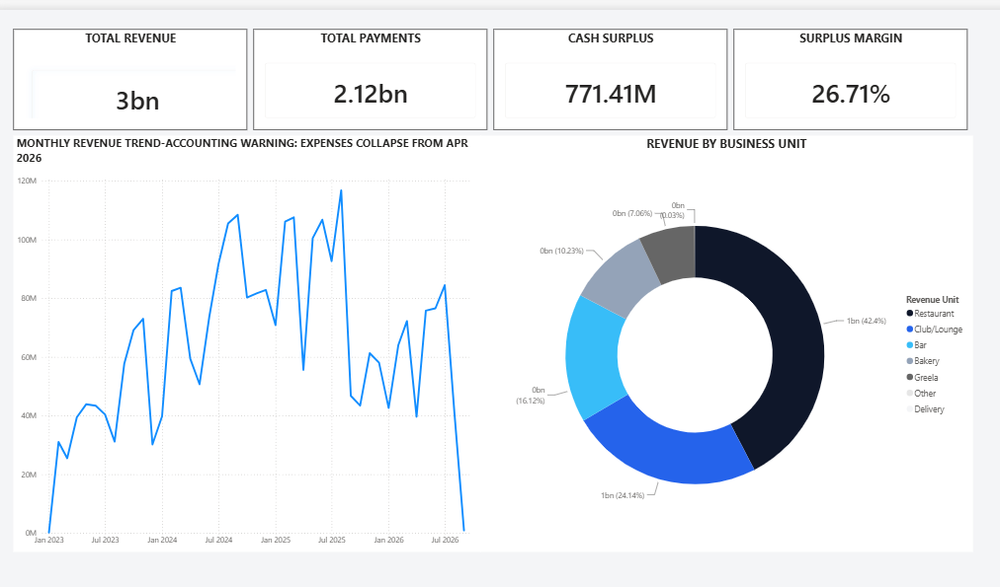
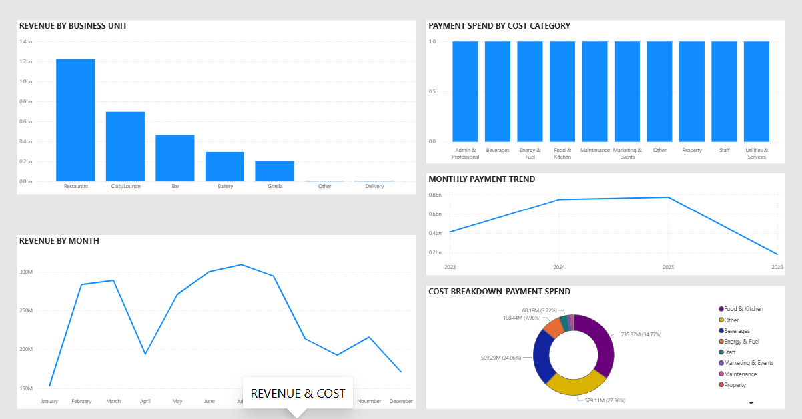
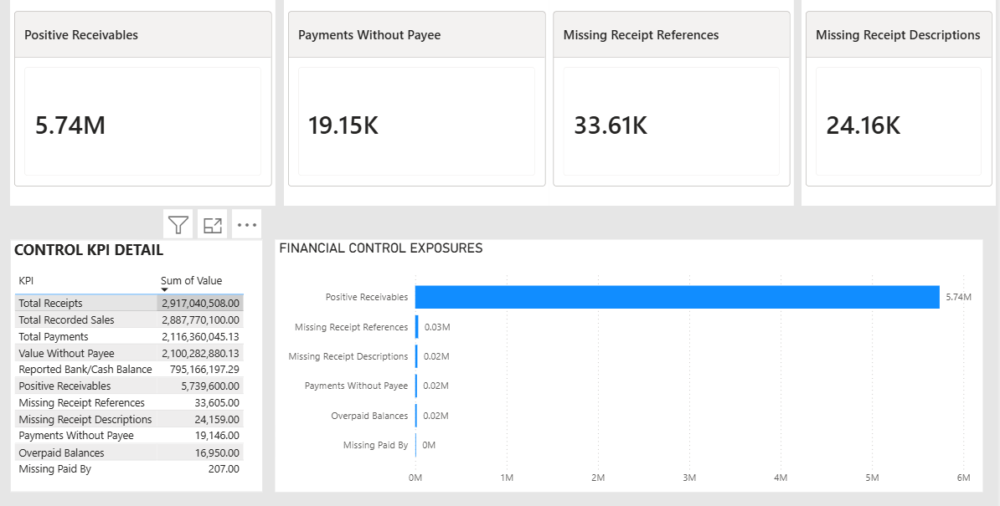

# Restaurant Financial Intelligence & CEO Dashboard

> **Portfolio case study:** https://aboladvisuals.github.io/projects/restaurant-financial-intelligence/

## Executive Summary

A decision-focused financial analytics project built to evaluate revenue, payments, profitability, costs, financial controls and data quality for a multi-unit restaurant business.

The project transforms raw operational data into management-ready insights using **Python, SQL, Excel and Power BI**.

### Key Finding

The business generates substantial recorded financial activity, but weaknesses in expense recording and transaction controls reduce confidence in reported profitability.

**Management priority: fix financial visibility and controls before optimising reported profit.**

---

## Key Financial Snapshot

| Metric | Result |
|---|---:|
| Recorded Sales | ₦2.888bn |
| Total Receipts | ₦2.917bn |
| Total Payments | ₦2.116bn |
| Reported Bank/Cash | ₦795.17m |
| Restaurant Revenue Share | ~42.4% |
| Restaurant + Club/Lounge | ~66.5% |

---

## Revenue & Cost Insights

### Revenue

The **Restaurant** is the largest revenue contributor, while **Restaurant + Club/Lounge** account for approximately two-thirds of recorded revenue.

### Payment Spend

| Category | Approx. Spend | Share |
|---|---:|---:|
| Food & Kitchen | ₦735.6m | 34.8% |
| Beverages | ₦510.0m | 24.1% |
| Other / Unclassified | ₦556.3m | 26.3% |

Food & Kitchen and Beverages together represent approximately **58.9% of recorded payments**.

"Other / Unclassified" indicates a transaction-classification weakness and does not, by itself, indicate fraud.

---

## Financial Control Risks

The analysis identified:

- **19,146** payments without Payee
- **33,605** receipts without Reference
- **24,159** receipts without Description
- Approximately **₦5.74m** in positive receivables
- Significant payment value without identifiable Payee information

These weaknesses reduce transaction traceability and the reliability of management reporting.

**Control weaknesses are not evidence of fraud.**

---

## Critical Accounting Issue

Recorded expenses **collapse from April 2026 onward**.

| Month | Recorded Expenses |
|---|---:|
| March 2026 | ~₦58.5m |
| April 2026 | ~₦2.1m |
| May 2026 | ~₦0.86m |
| June 2026 | ~₦0.51m |
| July 2026 | ~₦0.41m |
| August 2026 | ~₦0.07m |

This creates unusually high apparent profit margins.

**Reported profitability from April 2026 onward should not be relied upon until the underlying expense records are reconciled.**

---

## CEO Action Priorities

1. Reconcile financial records from **April 2026 onward**.
2. Restore complete and consistent expense recording.
3. Make Payee, receipt reference and transaction descriptions mandatory where appropriate.
4. Reclassify major **Other / Unclassified** payments.
5. Introduce monthly bank reconciliation.
6. Strengthen purchasing and stock controls around Food & Beverage spend.

---

## Power BI Executive Dashboard

### CEO Overview



### Revenue & Cost



### Financial Controls



---

## Analytical Workflow

```text
Raw Data
   ↓
Data Audit & Validation
   ↓
Data Cleaning
   ↓
Financial & Revenue Analysis
   ↓
Cost & Control Analysis
   ↓
Management Action Plan
   ↓
Dashboard Data Layer
   ↓
Power BI Executive Dashboard

Tools & Skills

Python · Pandas · SQL · Excel · Power BI · Power Query · Data Cleaning · Financial Analysis · Data Quality · Financial Controls · Dashboard Design · Executive Reporting

restaurant_ceo_analysis/
├── data/
├── notebooks/
├── outputs/
├── scripts/
├── screenshots/
├── website/
└── README.md

Management Takeaway

Fix financial visibility, strengthen controls and reconcile the reporting gap before making major profitability decisions.